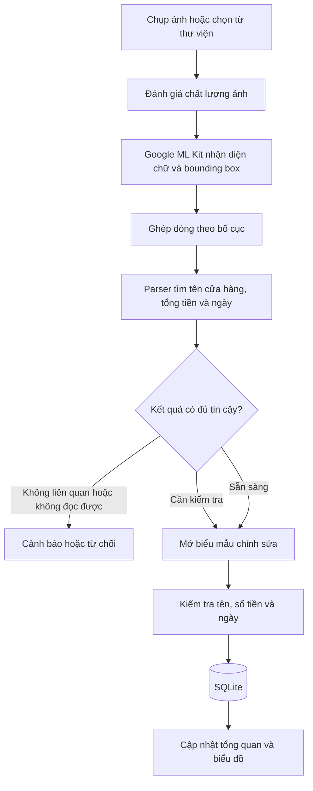
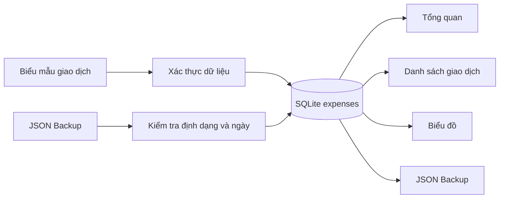

# BÁO CÁO KỸ THUẬT MINI-PROJECT 3

**Học phần:** Lập trình ứng dụng di động đa nền tảng (VKU)

**Tên đề tài:** Receiptly — Ứng dụng quản lý chi tiêu và nhận diện hóa đơn bằng OCR

**Sinh viên:** Phạm Anh Quyền

**Mã sinh viên:** 23IT.B181

**Ngày sinh:** 01/01/2005
**Ngày hoàn thành báo cáo:** 25/10/2026

---

## 1. THÔNG TIN CHUNG

### 1.1. Thông tin sinh viên

| Họ và tên | Mã sinh viên | Vai trò | Mức đóng góp |
|---|---|---|:---:|
| Phạm Anh Quyền | 23IT.B181 | Phát triển cá nhân — phân tích, UI/UX, Flutter, OCR, SQLite và kiểm thử | 100% |

### 1.2. Thông tin sản phẩm

- **Tên ứng dụng:** Receiptly
- **Loại ứng dụng:** Ứng dụng di động quản lý chi tiêu cá nhân
- **Nền tảng mục tiêu:** Android
- **Framework:** Flutter / Dart
- **Tên package Android hiện tại:** `com.example.receiptly`
- **Phiên bản khai báo:** `1.1.0+2`
- **GitHub Repository:** <https://github.com/quyen-jr/receiptmanagerment>
- **Live Demo / PWA:** <https://quyen-jr.github.io/receiptmanagerment/>
- **APK đầu ra dự kiến:** `dist/Receiptly-v1.1.0.apk`

### 1.3. Tổng quan đề tài

Receiptly hỗ trợ người dùng ghi chép và phân tích chi tiêu cá nhân ngay trên điện thoại. Người dùng có thể nhập giao dịch thủ công hoặc chụp/chọn ảnh hóa đơn. Ứng dụng sử dụng Google ML Kit Text Recognition để nhận diện chữ trực tiếp trên thiết bị, sau đó kết hợp biểu thức chính quy và các quy tắc heuristic để đề xuất tên cửa hàng, tổng tiền và ngày giao dịch.

Trước khi lưu, người dùng luôn được kiểm tra và chỉnh sửa dữ liệu OCR. Giao dịch được lưu cục bộ trong SQLite, không yêu cầu tài khoản, máy chủ hay kết nối Internet. Ứng dụng còn cung cấp thống kê theo tháng, biểu đồ theo danh mục, biểu đồ chi tiêu bảy ngày và chức năng sao lưu/khôi phục bằng JSON.

---

## 2. MỤC TIÊU VÀ PHẠM VI

### 2.1. Mục tiêu

1. Xây dựng ứng dụng Flutter có giao diện thân thiện trên điện thoại Android.
2. Thực hiện đầy đủ thao tác thêm, xem, sửa và xóa giao dịch.
3. Nhận diện nội dung hóa đơn bằng OCR ngay trên thiết bị.
4. Trích xuất các trường quan trọng từ văn bản OCR có bố cục không đồng nhất.
5. Lưu dữ liệu bền vững trong SQLite và hỗ trợ chuyển đổi dữ liệu cũ.
6. Trực quan hóa chi tiêu bằng biểu đồ động tự vẽ.
7. Bảo vệ tính hợp lệ của dữ liệu bằng các quy tắc ngày và kiểm thử tự động.

### 2.2. Phạm vi

Ứng dụng tập trung vào quản lý chi tiêu cá nhân trên một thiết bị. Phiên bản hiện tại không có đăng nhập, backend hoặc đồng bộ đám mây. OCR và các quy tắc phân tích chạy cục bộ; độ chính xác phụ thuộc vào chất lượng ảnh, bố cục và cách in của từng hóa đơn.

---

## 3. DANH SÁCH CHỨC NĂNG ĐÃ TRIỂN KHAI

| # | Chức năng | Trạng thái | Chi tiết triển khai |
|:---:|---|:---:|---|
| 1 | Giao diện di động | ✅ Hoàn thành | Giao diện Material 3 với bảng màu xanh rêu, cam san hô và nền giấy ấm; header riêng, thanh điều hướng nổi và bố cục tối ưu cho thao tác chạm. |
| 2 | Tổng quan theo tháng | ✅ Hoàn thành | Hiển thị tổng tiền, số giao dịch, danh mục chi nhiều nhất và các giao dịch gần đây. |
| 3 | Quản lý giao dịch | ✅ Hoàn thành | Thêm, xem, sửa, xóa và phân loại giao dịch theo sáu danh mục. |
| 4 | Điều hướng tháng | ✅ Hoàn thành | Cho phép xem tháng trước và chặn điều hướng tới tháng tương lai. |
| 5 | Chụp/chọn ảnh hóa đơn | ✅ Hoàn thành | Sử dụng `image_picker` để nhận ảnh từ camera hoặc thư viện. |
| 6 | OCR ngoại tuyến | ✅ Hoàn thành | Google ML Kit nhận diện chữ Latin và vị trí từng dòng ngay trên thiết bị. |
| 7 | Đánh giá chất lượng ảnh | ✅ Hoàn thành | Package `image` được dùng để phát hiện ảnh quá mờ trước khi chấp nhận kết quả. |
| 8 | Phân tích hóa đơn | ✅ Hoàn thành | Regex và heuristic trích xuất tên cửa hàng, tổng tiền và ngày; ưu tiên nhãn tổng thanh toán và loại trừ địa chỉ, số điện thoại, mã đơn. |
| 9 | Kiểm tra kết quả OCR | ✅ Hoàn thành | Kết quả được mở trong biểu mẫu để người dùng xác nhận hoặc chỉnh sửa trước khi lưu. |
| 10 | Kiểm soát ngày | ✅ Hoàn thành | Chỉ chấp nhận ngày từ năm 2000 đến ngày hiện tại; từ chối ngày tương lai ở biểu mẫu, tầng lưu trữ và lúc nhập backup. |
| 11 | Lưu trữ SQLite | ✅ Hoàn thành | Dữ liệu được lưu trong `receiptly.db`, bảng `expenses`, qua package `sqflite`. |
| 12 | Chuyển dữ liệu cũ | ✅ Hoàn thành | Dữ liệu từ SharedPreferences `expenses_v1` được chuyển sang SQLite một lần và không nhân đôi bản ghi. |
| 13 | Sao lưu và khôi phục | ✅ Hoàn thành | Xuất JSON bằng `share_plus`; chọn và nhập JSON bằng `file_picker`; bản ghi trùng ID được cập nhật. |
| 14 | Thống kê trực quan | ✅ Hoàn thành | Biểu đồ tròn theo danh mục và biểu đồ cột chồng bảy ngày được vẽ bằng `CustomPainter`. |
| 15 | Hiệu ứng biểu đồ | ✅ Hoàn thành | `AnimationController` tạo chuyển động khi biểu đồ xuất hiện hoặc dữ liệu thay đổi. |
| 16 | Kiểm thử tự động | ✅ Hoàn thành | Có unit test cho parser, quy tắc ngày và widget test khởi chạy ứng dụng. |
| 17 | Tự động build APK | ✅ Đã cấu hình | GitHub Actions chạy script build và tải APK lên dưới dạng artifact khi push vào `main` hoặc `master`. |

---

## 4. CÔNG NGHỆ VÀ KIẾN TRÚC

### 4.1. Công nghệ sử dụng

| Thành phần | Công nghệ / package |
|---|---|
| Ngôn ngữ và UI | Dart, Flutter Material 3 |
| OCR trên thiết bị | `google_mlkit_text_recognition` |
| Camera và thư viện ảnh | `image_picker` |
| Phân tích chất lượng ảnh | `image` |
| Cơ sở dữ liệu | `sqflite`, `path` |
| Dữ liệu phiên bản cũ | `shared_preferences` |
| Chọn tệp backup | `file_picker` |
| Chia sẻ tệp backup | `share_plus` |
| Thư mục tạm | `path_provider` |
| Định dạng ngày và tiền tệ | `intl` |
| Biểu đồ | `CustomPainter`, `AnimationController` |
| Kiểm thử | `flutter_test`, `flutter_lints` |

### 4.2. Kiến trúc logic

Dự án được tổ chức thành ba nhóm trách nhiệm chính:

- **Tầng trình bày:** `lib/main.dart` quản lý theme, màn hình tổng quan, danh sách giao dịch, thống kê, biểu mẫu nhập liệu và điều hướng.
- **Tầng xử lý nghiệp vụ:** `receipt_parser.dart`, `receipt_image_quality.dart` và `transaction_date_rules.dart` xử lý OCR, đánh giá ảnh và xác thực ngày.
- **Tầng dữ liệu:** `expense_store.dart` chịu trách nhiệm SQLite, migration, truy vấn và nhập dữ liệu sao lưu.

### 4.3. Cấu trúc dự án

```text
Receipt-management/
├── .github/workflows/
│   └── android-apk.yml              # Workflow build APK trên GitHub Actions
├── android/                         # Dự án Android và cấu hình Gradle
├── lib/
│   ├── main.dart                    # Giao diện, điều hướng và luồng ứng dụng
│   ├── expense_store.dart           # SQLite và migration SharedPreferences
│   ├── receipt_parser.dart          # Parser văn bản/bố cục và xác thực OCR
│   ├── receipt_image_quality.dart   # Đánh giá độ rõ của ảnh
│   └── transaction_date_rules.dart  # Quy tắc ngày và tháng hợp lệ
├── test/
│   ├── receipt_parser_test.dart
│   ├── transaction_date_rules_test.dart
│   └── widget_test.dart
├── build_android.ps1                # Script build trên Windows
├── build_android.sh                 # Script build trên Linux/CI
├── BUILD_APK_WINDOWS.bat            # Lối tắt build APK trên Windows
├── pubspec.yaml                     # Phiên bản, SDK và dependencies
└── README.md                        # Hướng dẫn kỹ thuật chi tiết
```

### 4.4. Mô hình dữ liệu giao dịch

| Trường | Kiểu | Ý nghĩa |
|---|---|---|
| `id` | `String` | Khóa chính, tạo từ microsecond timestamp |
| `merchant` | `String` | Tên cửa hàng hoặc nội dung khoản chi |
| `category` | `String` | Danh mục chi tiêu |
| `note` | `String` | Ghi chú tùy chọn |
| `amount` | `double` | Số tiền, bắt buộc lớn hơn 0 |
| `date` | `DateTime` / ISO 8601 | Ngày giao dịch hợp lệ |

SQLite sử dụng bảng `expenses`. Phương thức `upsert` dùng cơ chế thay thế khi trùng khóa chính, giúp cùng một ID có thể được cập nhật khi chỉnh sửa hoặc khôi phục từ backup.

---

## 5. LUỒNG HOẠT ĐỘNG

### 5.1. Luồng quét hóa đơn



### 5.2. Chiến lược phân tích OCR

Parser không chỉ đọc chuỗi văn bản thuần. Ứng dụng lấy `boundingBox` của từng dòng OCR, gom các dòng gần nhau thành hàng và tìm số tiền nằm cạnh hoặc ngay sau nhãn như “Tổng cộng”, “Tổng thanh toán”, “Amount due” hoặc “Grand total”. Các biểu thức loại trừ giúp hạn chế nhầm số nhà, hotline, mã hóa đơn, thuế, tiền thừa hoặc đơn giá thành tổng thanh toán.

Tên cửa hàng được ưu tiên từ các dòng đầu hóa đơn nhưng loại bỏ các dòng có đặc điểm của sản phẩm, địa chỉ, ngày giờ hoặc số tiền. Ngày giao dịch hỗ trợ nhiều định dạng số và một số cách viết tiếng Việt. Khi thiếu trường nhưng nội dung vẫn có dấu hiệu là hóa đơn thật, ứng dụng cho phép người dùng tự bổ sung thay vì từ chối cứng.

### 5.3. Luồng lưu trữ và sao lưu



Tất cả dữ liệu được ghi cục bộ. Bản backup chứa trường nhận dạng định dạng, số phiên bản, thời điểm xuất và danh sách giao dịch. Khi nhập, ứng dụng kiểm tra cấu trúc JSON và tính hợp lệ của từng ngày trước khi ghi vào SQLite.

---

## 6. THIẾT KẾ GIAO DIỆN

Giao diện hiện tại sử dụng phong cách “sổ chi tiêu hiện đại”, khác với bố cục Material mặc định:

- Nền giấy màu kem tạo cảm giác nhẹ và gần với hóa đơn thực tế.
- Xanh rêu đậm được dùng cho tổng tiền và thanh điều hướng.
- Cam san hô làm màu nhấn cho nút quét và các hành động quan trọng.
- Thanh điều hướng nổi gồm Tổng quan, Giao dịch, Phân tích và nút Quét tích hợp.
- Màn hình Tổng quan ưu tiên tổng chi, số giao dịch và danh mục chi nhiều nhất.
- Màn hình Giao dịch được trình bày như một cuốn sổ, sắp xếp mới nhất trước.
- Màn hình Phân tích kết hợp biểu đồ tròn, tỷ lệ từng danh mục và cột chồng bảy ngày.
- Biểu mẫu thêm/sửa và các bottom sheet được thiết kế đồng bộ với hệ màu và bo góc chung.

Thiết kế vẫn giữ đầy đủ khả năng truy cập cơ bản: tooltip cho nút biểu tượng, nhãn ngữ nghĩa cho nút quét, vùng chạm lớn và độ tương phản rõ giữa nội dung với nền.

---

## 7. KIỂM THỬ VÀ MINH CHỨNG

### 7.1. Kết quả kiểm thử tự động

Tại thời điểm cập nhật báo cáo ngày 25/10/2026, lệnh sau đã được chạy:

```powershell
flutter test --no-pub
```

Kết quả: **26/26 test passed**.

Bộ test bao gồm:

- Trích xuất tổng tiền và ngày từ hóa đơn tiếng Việt.
- Ưu tiên tổng thanh toán thay vì tiền thừa hoặc số tiền không liên quan.
- Loại trừ số nhà, số điện thoại và dòng sản phẩm khỏi kết quả.
- Phân tích các mẫu ĐẸP COFFEE, AN NAM và THE NOODLE HOUSE.
- Phân biệt hóa đơn thật, văn bản không liên quan và trường hợp cần người dùng kiểm tra.
- Xác thực ngày hiện tại, ngày quá khứ và giới hạn tháng tương lai.
- Widget test xác nhận ứng dụng Receiptly khởi chạy được.

### 7.2. Kịch bản kiểm thử thủ công đề xuất

| ID | Kịch bản | Kết quả mong đợi |
|---|---|---|
| CRUD01 | Thêm, sửa rồi xóa một giao dịch | Danh sách, tổng tiền và biểu đồ cập nhật đúng |
| DB01 | Đóng và mở lại ứng dụng | Dữ liệu vẫn còn trong SQLite |
| OCR01 | Chụp hóa đơn rõ, có nhãn tổng | Tên, tổng tiền và ngày được đề xuất hợp lý |
| OCR02 | Chọn ảnh mờ hoặc không có chữ | Ứng dụng yêu cầu chọn/chụp lại |
| OCR03 | Quét nội dung không phải hóa đơn | Hiển thị cảnh báo hoặc từ chối phù hợp |
| OCR04 | Hóa đơn thiếu ngày | Mở biểu mẫu và yêu cầu người dùng chọn ngày |
| DATE01 | Chọn ngày tương lai | Không thể lưu giao dịch |
| DATE02 | Chuyển tới tháng tương lai | Nút chuyển tháng bị vô hiệu hóa |
| BACKUP01 | Xuất rồi nhập lại JSON | Dữ liệu hợp lệ được khôi phục, ID trùng được cập nhật |
| BACKUP02 | Nhập JSON sai định dạng | Hiển thị lỗi và không làm hỏng dữ liệu hiện tại |
| OFFLINE01 | Tắt Internet rồi quét hóa đơn | OCR và lưu dữ liệu vẫn hoạt động trên thiết bị |

### 7.3. Danh sách ảnh minh chứng cần chèn

1. Màn hình Tổng quan với tổng chi và giao dịch gần đây.
2. Bottom sheet chọn camera hoặc thư viện ảnh.
3. Biểu mẫu kiểm tra kết quả OCR trước khi lưu.
4. Màn hình Sổ giao dịch.
5. Màn hình Phân tích với biểu đồ tròn và biểu đồ bảy ngày.
6. Tệp JSON được xuất hoặc dữ liệu trong SQLite Database Inspector.
7. Terminal hiển thị kết quả `26 tests passed`.
8. APK chạy trên emulator hoặc thiết bị Android thật.

> Các ảnh chụp thực tế cần được bổ sung trước khi xuất báo cáo cuối cùng sang PDF nếu giảng viên yêu cầu minh chứng trực quan.

---

## 8. KHÓ KHĂN KỸ THUẬT VÀ GIẢI PHÁP

### 8.1. Hóa đơn có bố cục và cách ghi không đồng nhất

**Khó khăn:** Mỗi cửa hàng có cách bố trí nhãn tổng, số tiền, ngày và tên khác nhau. OCR có thể tách nhãn và số tiền thành hai dòng hoặc đọc sai dấu phân cách.

**Giải pháp:** Ứng dụng kết hợp văn bản với tọa độ dòng, gom các dòng gần nhau theo bố cục và dùng nhiều regex/heuristic thay vì phụ thuộc vào một mẫu cố định. Nhãn tổng được ưu tiên, còn địa chỉ, điện thoại, thuế, đơn giá và tiền thừa được đưa vào danh sách loại trừ.

### 8.2. Cân bằng giữa phát hiện sai và từ chối nhầm hóa đơn thật

**Khó khăn:** Nếu điều kiện quá lỏng, ảnh không liên quan có thể được chấp nhận; nếu quá chặt, hóa đơn thật thiếu một trường lại bị loại bỏ.

**Giải pháp:** `ReceiptValidation` chia kết quả thành ba mức: từ chối, cần kiểm tra và sẵn sàng. Chỉ ảnh không đọc được hoặc có dấu hiệu rõ ràng không phải hóa đơn mới bị từ chối. Các trường hợp chưa chắc chắn được chuyển sang biểu mẫu để người dùng quyết định.

### 8.3. Bảo toàn dữ liệu khi thay đổi cơ chế lưu trữ

**Khó khăn:** Phiên bản đầu lưu JSON trong SharedPreferences, không phù hợp khi số giao dịch tăng và khó truy vấn.

**Giải pháp:** `ExpenseStore` chuyển dữ liệu cũ sang SQLite trong một transaction. Cờ migration chỉ được ghi sau khi transaction thành công; bản dữ liệu cũ không bị xóa ngay, giúp giảm rủi ro mất dữ liệu.

### 8.4. Kiểm soát ngày theo thời gian thực

**Khó khăn:** Ứng dụng có thể được mở qua thời điểm chuyển ngày hoặc chuyển tháng, làm giới hạn ngày cũ trở nên không chính xác.

**Giải pháp:** Ngày hiện tại được tính lại tại thời điểm thao tác và kiểm tra lại lúc lưu. Ứng dụng cũng cập nhật giới hạn khi quay lại foreground và định kỳ khi đang mở.

### 8.5. Trực quan hóa không phụ thuộc thư viện biểu đồ

**Khó khăn:** Cần biểu diễn tỷ lệ danh mục và chi tiêu bảy ngày, đồng thời giữ giao diện nhẹ và đồng bộ.

**Giải pháp:** Biểu đồ được tự vẽ bằng `CustomPainter`; cột bảy ngày được xếp chồng theo danh mục và dùng chung bảng màu với biểu đồ tròn. `AnimationController` điều khiển tiến trình vẽ để tạo hiệu ứng mượt.

---

## 9. HẠN CHẾ VÀ AN TOÀN DỮ LIỆU

- ML Kit chỉ nhận diện chữ; kết quả tên cửa hàng, tổng tiền và ngày vẫn do parser heuristic suy luận nên không đảm bảo chính xác tuyệt đối.
- Ảnh thiếu sáng, bị cắt, rung, font đặc biệt hoặc hóa đơn nhiều cột có thể tạo kết quả sai.
- Dữ liệu chỉ nằm trên thiết bị và không tự đồng bộ sang thiết bị khác.
- Gỡ ứng dụng hoặc xóa dữ liệu ứng dụng có thể làm mất SQLite nếu chưa sao lưu.
- Backup JSON chưa được mã hóa; người dùng không nên tải công khai hoặc commit tệp này lên repository.
- Package Android hiện dùng namespace mẫu `com.example.receiptly`; cần đổi sang định danh chính thức trước khi phát hành rộng rãi.
- Cấu hình ký release cần sử dụng keystore ổn định và phải giữ bí mật mật khẩu/khóa ký.

---

## 10. CÀI ĐẶT, CHẠY VÀ BUILD

### 10.1. Yêu cầu môi trường

- Flutter SDK tương thích Dart `>=3.8.0 <4.0.0`.
- Android Studio, Android SDK và JDK 17.
- Android Emulator hoặc điện thoại Android bật chế độ nhà phát triển.
- Internet cho lần đầu tải dependencies; ứng dụng không cần backend khi sử dụng.

### 10.2. Chạy dự án

```powershell
flutter pub get
flutter analyze
flutter test
flutter devices
flutter run -d <device-id>
```

### 10.3. Build APK

```powershell
flutter build apk --release
```

APK mặc định được tạo tại:

```text
build/app/outputs/flutter-apk/app-release.apk
```

Trên Windows có thể chạy:

```powershell
.\BUILD_APK_WINDOWS.bat
```

Script sẽ build và sao chép APK sang:

```text
dist/Receiptly-v1.1.0.apk
```

Repository cũng có workflow `.github/workflows/android-apk.yml` để build artifact khi push lên nhánh `main` hoặc `master`.

---

## 11. KẾT LUẬN VÀ HƯỚNG PHÁT TRIỂN

Receiptly đáp ứng mục tiêu của một ứng dụng Flutter quản lý chi tiêu có tích hợp OCR. Sản phẩm đã kết hợp được giao diện di động, camera/thư viện ảnh, Google ML Kit, parser theo bố cục, SQLite, backup JSON, biểu đồ tự vẽ và kiểm thử tự động trong một ứng dụng hoạt động không phụ thuộc backend.

Các hướng phát triển tiếp theo:

1. Cải thiện parser bằng tập dữ liệu hóa đơn đa dạng hơn.
2. Lưu ảnh gốc hoặc vùng crop liên quan cùng giao dịch.
3. Thêm tìm kiếm, lọc theo khoảng thời gian và ngân sách theo danh mục.
4. Mã hóa backup và hỗ trợ đồng bộ tùy chọn giữa các thiết bị.
5. Thêm kiểm thử tích hợp cho SQLite, camera và quy trình backup/restore.
6. Đổi application ID chính thức, cấu hình keystore release và phát hành bản APK đã kiểm thử thực tế.

---

## 12. TÀI LIỆU THAM KHẢO

1. Flutter Documentation — <https://docs.flutter.dev/>
2. Dart Documentation — <https://dart.dev/docs>
3. Google ML Kit Text Recognition for Flutter — package `google_mlkit_text_recognition`
4. SQLite for Flutter — package `sqflite`
5. Material Design 3 — <https://m3.material.io/>
